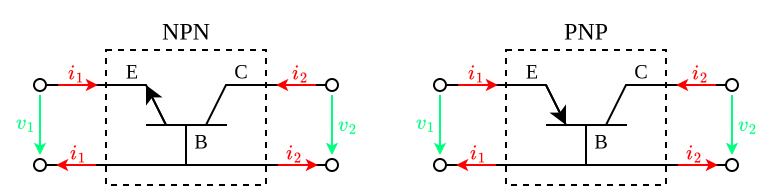
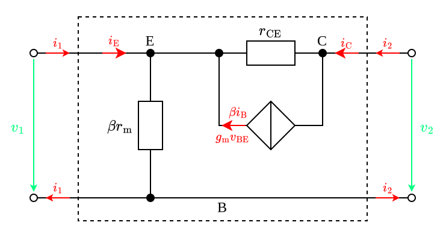

---
tags:
    - analog-circuits
    - electrical-engineering
---

# Common Base Amplifiers

>[!THEOREM] Theorem: Resistive Loading Effects
>
>$$R_{\text{in}} = (\beta r_{\text{m}}) \parallel \left( \frac{r_{\text{CE}} + R_{\text{L}}}{1 + g_{\text{m}} r_{\text{CE}}} \right) = \frac{\beta r_{\text{m}} (r_{\text{CE}} + R_{\text{L}})}{\beta r_{\text{m}} (1 + g_{\text{m}} r_{\text{CE}}) + r_{\text{CE}} + R_{\text{L}}}$$
>
>>[!TIP]
>>
>>For $R_2 \ll r_{\text{CE}}$:
>>
>>$$r_{\text{in}} \approx r_{\text{m}}$$
>>
>>For $R_2 \to \infty$:
>>
>>$$r_{\text{in}} \approx \beta r_{\text{m}}$$
>>
>
>$$R_{\text{out}} = r_{\text{CE}} + ((\beta r_{\text{m}}) || R_1) (1 + g_{\text{m}} r_{\text{CE}})$$
>
>>[!TIP]
>>
>>For $R_1 \ll \beta r_{\text{m}}$:
>>
>>$$R_{\text{out}} \approx r_{\text{CE}}\left( 1 + \frac{R_1}{r_{\text{m}}} \right)$$
>>
>
>$$A_{v} = \frac{1 + g_{\text{m}} r_{\text{CE}}}{1+\frac{r_{\text{CE}}}{R_2}}$$
>
>>[!TIP]
>>
>>Since $g_\text{m} r_{\text{CE}} \gg 1$:
>>
>>$$A_v \approx g_{\text{m}} (r_{\text{CE}} \parallel R_2)$$
>>
>>For $R_2 \ll r_{\text{CE}}$:
>>
>>$$A_v \approx g_{\text{m}} R_2$$
>>
>
>$$A_{i} = -\frac{\beta r_{\text{m}} (1 + g_{\text{m}} r_{\text{CE}})}{\beta r_{\text{m}} (1 + g_{\text{m}} r_{\text{CE}}) + r_{\text{CE}} + R_{\text{L}}}$$
>
>>[!TIP]
>>
>>Since $g_{\text{m}} r_{\text{CE}} \gg 1$
>>
>>$$A_i \approx -\frac{\beta}{\beta + \frac{R_2}{r_{\text{CE}}}}$$
>>
>>For $R_2 \ll r_{\text{CE}}$:
>>
>>$$A_i \approx -1$$
>>
>
>>[!PROOF]-
>>
>>TODO
>>
>