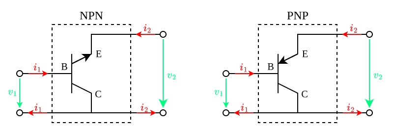
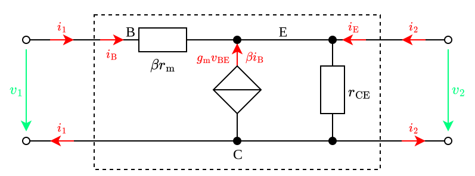

---
tags:
    - analog-circuits
    - electrical-engineering
---

# Common Collector Amplifiers

>[!THEOREM] Theorem: Resistive Loading Effects
>
>$$R_{\text{in}} = \beta r_{\text{m}} + (1+\beta)(r_{\text{CE}} \parallel R_{\text{L}})$$
>
>>[!TIP]
>>
>>Since $\beta +1 \approx \beta$:
>>
>>$$R_{\text{in}} \approx \beta (r_{\text{m}} + r_{\text{CE}} \parallel R_{\text{L}})$$
>>
>
>$$R_{\text{out}} = r_{\text{CE}} \parallel \left(\frac{R_{\text{S}} + \beta r_{\text{m}}}{1 + \beta}\right)$$
>
>>[!TIP]
>>
>>Since $r_{\text{CE}} \gg \left(\frac{R_1 + \beta r_{\text{m}}}{1 + \beta}\right)$:
>>
>>$$R_{\text{out}} \approx r_{\text{m}} + \frac{R_1}{\beta}$$
>>
>
>$$A_v = \frac{r_{\text{CE}} \parallel R_{\text{L}}}{\left(\frac{\beta}{1+\beta}\right) r_{\text{m}} + (r_{\text{CE}} \parallel R_{\text{L}})}$$
>
>>[!TIP]
>>
>>For $R_2 \gg r_{\text{m}}$:
>>
>>$$A_v \approx 1$$
>>
>
>$$A_i = -(1+\beta) \frac{r_{\text{CE}}}{r_{\text{CE}}+R_2}$$
>
>>[!PROOF]-
>>
>>TODO
>>
>