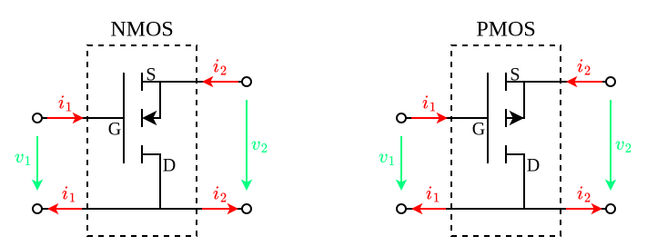
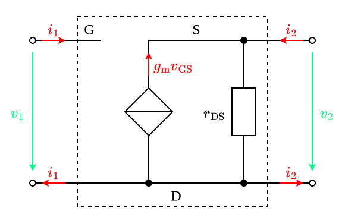

---
tags:
    - analog-circuits
    - electrical-engineering
---

# Common Drain Amplifiers

>[!THEOREM] Theorem: Resistive Loading Effects
>
>$$R_{\text{in}} = \infty$$
>
>$$A_v = \frac{g_{\text{m}} (r_{\text{DS}} \parallel R_2)}{1+g_{\text{m}}(r_{\text{DS}}\parallel R_2)} \approx 1$$
>
>$$R_{\text{out}} = r_{\text{DS}}\parallel r_{\text{m}} \approx r_{\text{m}}$$
>
>>[!PROOF]-
>>
>>TODO
>>
>