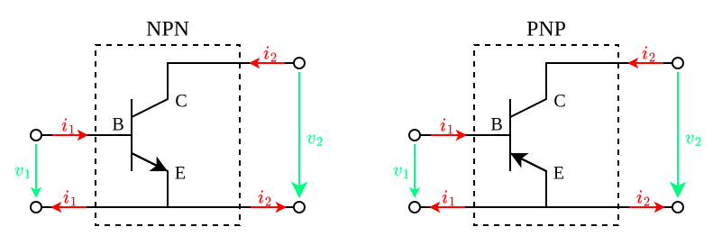
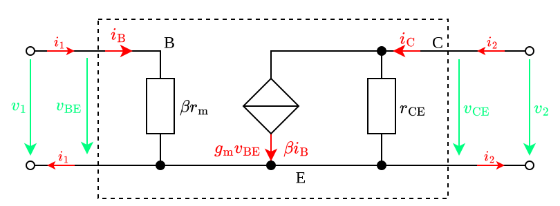
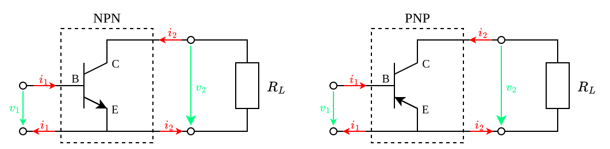
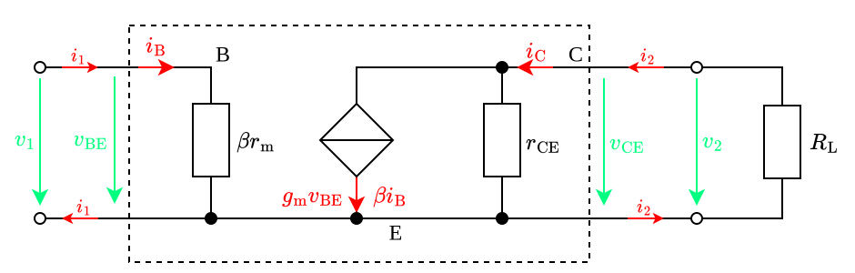

---
tags:
    - analog-circuits
    - electrical-engineering
---

# Common Emitter Amplifier

Input Resistance:

$$r_{\text{in}} \overset{\text{def}}{=} \frac{v_1}{i_1} = \beta r_{\text{m}}$$

Output Resistance:

$$r_{\text{out}} = r_{\text{CE}}$$

Open-Loop Voltage Gain:

$$A_v \overset{\text{def}}{=} \left.\frac{v_2}{v_1}\right\vert_{i_2 = 0} = -\frac{r_{\text{CE}}}{r_\text{m}}$$

Short-Circuit Current Gain:

$$A_i \overset{\text{def}}{=} \left.\frac{i_2}{i_1}\right\vert_{v_2 = 0} = \beta$$

## Resistive Loading

|Transistor Two-Port Parameter|Symbol|Definition|Value|
|:--:|:--:|:--:|:--:|
|Input resistance|$r_{\text{in, T}}$|$\frac{v_{1,\text{T}}}{i_{1, \text{T}}}$|$\beta r_{\text{m}}$|
|Output resistance|$r_{\text{out, T}}$|$\frac{v_{2,\text{T}}}{i_{2, \text{T}}}$|$r_{\text{CE}}$|
|Voltage gain|$A_{v, \text{T}}$|$\frac{v_{2, \text{T}}}{v_{1, \text{T}}}$|$-\frac{r_{\text{CE}} \parallel R_{\text{L}}}{r_{\text{m}}}$|
|Current gain|$A_{i, \text{T}}$|$\frac{i_{2, \text{T}}}{i_{1, \text{T}}}$|$\beta\frac{r_{\text{CE}}\parallel R_{\text{L}}}{R_{\text{L}}}$|

Input resistance:

$$r_{\text{in}} \overset{\text{def}}{=} \frac{v_{1,\text{T}}}{i_{1,\text{T}}} = \beta r_{\text{m}}$$

Output resistance:

$$r_{\text{out}}$$

Voltage gain:

$$A_v \overset{\text{def}}{=} -\frac{r_{\text{CE}} \parallel R_{\text{L}}}{r_{\text{m}}}$$

Current gain:

$$$$