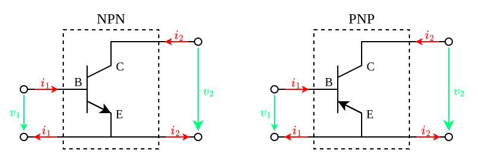
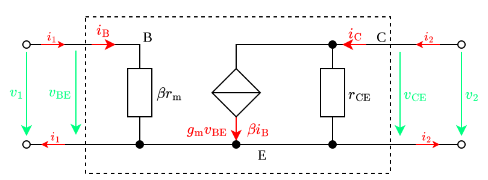
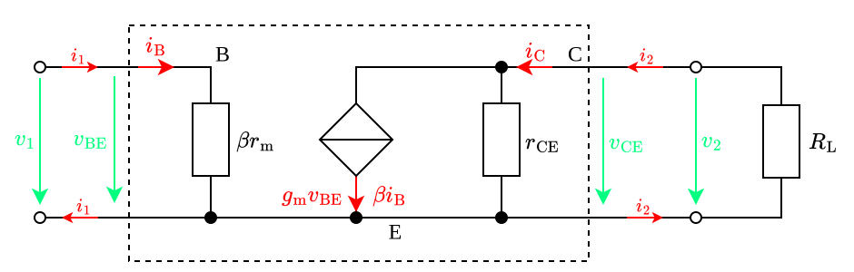
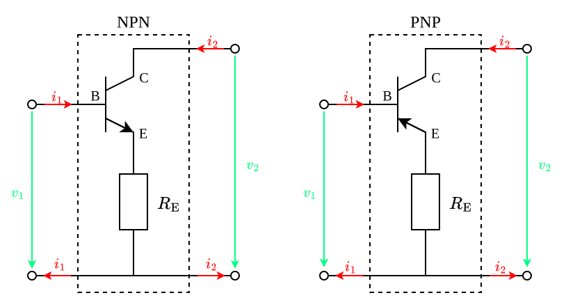
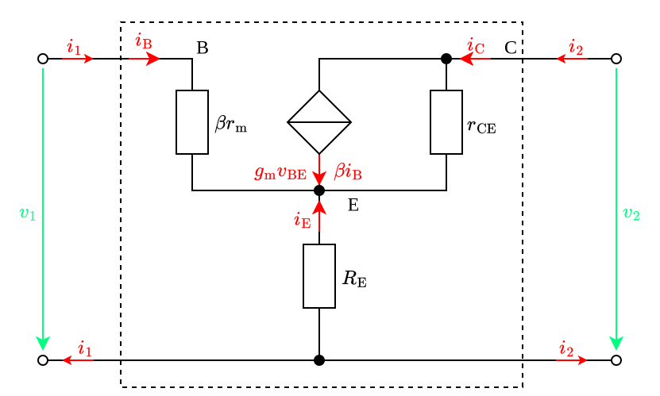

---
tags:
    - analog-circuits
    - electrical-engineering
---

# Common Emitter Amplifiers

>[!THEOREM] Theorem: Two-Port Parameters
>
>$$\begin{bmatrix} v_1 \\ v_2 \end{bmatrix} = \begin{bmatrix} \beta r_{\text{m}} & 0 \\ - \beta r_{\text{CE}} & r_{\text{CE}} \end{bmatrix} \begin{bmatrix}i_1 \\ i_2\end{bmatrix}$$
>
>>[!PROOF]-
>>
>>TODO
>>
>

>[!THEOREM] Theorem: Resistive Loading Effects
>
>
>
>$$r_{\text{in}} = \beta r_{\text{m}}$$
>
>$$r_{\text{out}} = r_{\text{CE}}$$
>
>$$A_{v} = -\frac{r_{\text{CE}} \parallel R_{2}}{r_{\text{m}}} = -\frac{g_{\text{m}}}{g_{\text{CE}} + G_{2}}$$
>
>$$A_{i} = \beta \frac{r_{\text{CE}}}{r_{\text{CE}}+R_{2}}$$
>
>>[!PROOF]-
>>
>>TODO
>>
>

## Emitter Degeneration

>[!THEOREM] Theorem: Two-Port Parameters
>
>$$\begin{bmatrix} v_1 \\ v_2 \end{bmatrix} = \begin{bmatrix} \beta r_{\text{m}} + R_{\text{E}} & R_{\text{E}} \\ R_{\text{E}} - \beta r_{\text{CE}} & R_{\text{E}} + r_{\text{CE}} \end{bmatrix} \begin{bmatrix}i_1 \\ i_2\end{bmatrix}$$
>
>>[!PROOF]-
>>
>>TODO
>>
>

$$r_{\text{in}} \overset{\text{def}}{=} \frac{v_1}{i_1} = $$

Loading effects:

>[!THEOREM] Theorem: Resistive Load Effects
>
>$$r_{\text{in}} = \beta r_{\text{m}} + R_{\text{E}} \frac{(\beta + 1)r_{\text{CE}} + R_{2}}{r_{\text{CE}} + R_{\text{E}} + R_{2}}$$
>
>>[!TIP] Tip: Input Resistance Approximation
>>
>>$$r_{\text{in}} \approx \beta (r_{\text{m}} + r_{\text{E}})$$
>>
>
>$$r_{\text{out}} = r_{\text{CE}} + R_{\text{E}} \left( \frac{R_{1} + \beta r_{\text{m}} + \beta r_{\text{CE}}}{R_{1} + \beta r_{\text{m}} + R_{\text{E}}} \right)$$
>
>>[!TIP]
>>
>>$$r_{\text{out}} \approx r_{\text{CE}}(1 + g_{\text{m}} R_{\text{E}})$$
>>
>
>$$A_v = \frac{R_{2} (R_{\text{E}} - \beta r_{\text{CE}})}{\beta r_{\text{m}} (r_{\text{CE}} + R_{\text{E}} + R_{2}) + R_{\text{E}} [(1+\beta)r_{\text{CE}} + R_{2}]}$$
>
>>[!TIP]
>>
>>Since $\beta \to \infty, R_S \to 0, \beta r_{CE} \gg R_E$:
>>
>>$$A_v \approx \displaystyle -\frac{g_m (R_L \parallel [r_{\text{CE}}(1+g_m R_E)])}{1+g_m R_E}$$
>>
>
>$$A_i = \frac{\beta r_{\text{CE}} - R_{\text{E}}}{r_{\text{CE}} + R_{\text{E}} + R_{\text{L}}}$$
>
>>[!TIP]
>>
>>Since $r_{\text{CE}} \gg R_{\text{E}}, R_{\text{L}}$:
>>
>>$$A_i \approx \beta$$
>>
>
>>[!PROOF]-
>>
>>TODO
>>
>

