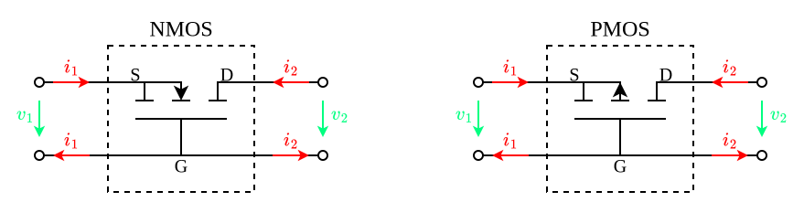
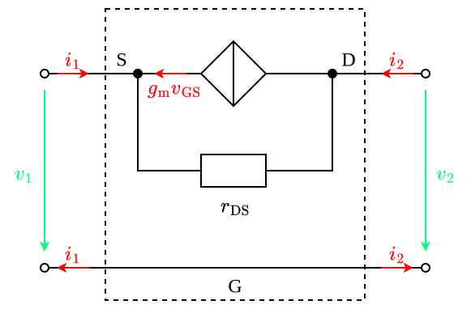

---
tags:
    - analog-circuits
    - electrical-engineering
---

# Common Gate Amplifiers

>[!THEOREM] Theorem: Resistive Loading Effects
>
>$$R_{\text{in}} = \frac{r_{\text{DS}} + R_2}{1 + g_{\text{m}} r_{\text{DS}}}$$
>
>>[!TIP]
>>
>>Since $r_{\text{DS}} \to \infty$:
>>
>>$$R_{\text{in}} \approx r_{\text{m}}$$
>>
>
>$$A_v = \left(g_{\text{m}} + \frac{1}{r_{\text{DS}}}\right)(r_{\text{DS}} \parallel R_2) \approx g_{\text{m}} (r_{\text{DS}} \parallel R_2)$$
>
>$$A_i = -1$$
>
>$$R_{\text{out}} = r_{\text{DS}} + R_1 (1 + g_{\text{m}} r_{\text{DS}})$$
>
>>[!PROOF]-
>>
>>TODO
>>
>

