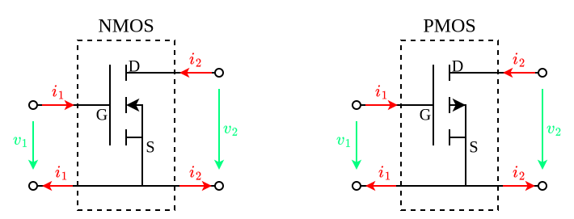
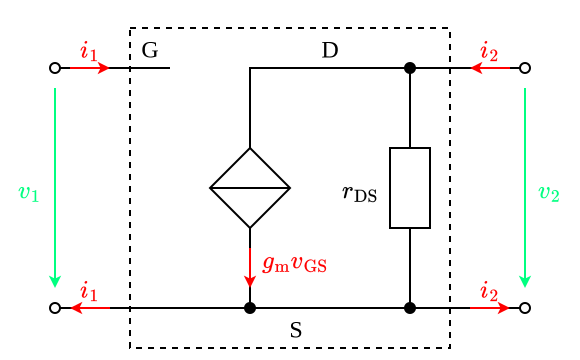

---
tags:
    - analog-circuits
    - electrical-engineering
---

# Common Source Amplifiers

>[!THEOREM] Theorem: Two-Port Matrix Representations
>
>$$\underset{\boldsymbol{i}}{\underbrace{\begin{bmatrix}i_1 \\ i_2\end{bmatrix}}} = \underset{\boldsymbol{G}}{\underbrace{\begin{bmatrix} 0 & 0 \\ g_{\text{m}} & \frac{1}{r_{\text{DS}}} \end{bmatrix}}} \underset{\boldsymbol{v}}{\underbrace{\begin{bmatrix}v_1 \\ v_2\end{bmatrix}}}$$
>
>>[!PROOF]-
>>
>>TODO
>>
>

>[!THEOREM] Theorem: Resistive Loading Effects
>
>$$R_{\text{in}} = \infty$$
>
>$$R_{\text{out}} = r_{\text{DS}}$$
>
>$$A_v = -g_{\text{m}} (r_{\text{DS}} \parallel R_2)$$
>
>$$A_i = \infty$$
>
>>[!PROOF]-
>>
>>TODO
>>
>