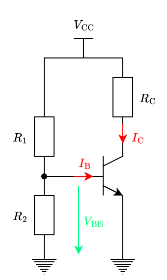

---
tags:
    - electrical-circuits
---

# BJT Biasing

## Base-Emitter Voltage Biasing

**Base-emitter voltage biasing** refers to the forcing of a specific [base-emitter voltage](../../Transistors/Bipolar%20Junction%20Transistor.md) $V_{\text{BE}}$.

This is most commonly done using a [voltage divider](TODO):

A major problem with this configuration is the very high temperature sensitivity of the [base current](../../Transistors/Bipolar%20Junction%20Transistor.md) $I_{\text{B}}$. Temperature variations shift the [input characteristic](../../Transistors/Bipolar%20Junction%20Transistor.md#Input%20Characteristic) of the [BJT](../../Transistors/Bipolar%20Junction%20Transistor.md) left and right, while the [base-emitter voltage](../../Transistors/Bipolar%20Junction%20Transistor.md) $V_{\text{BE}}$ remains fixed. This causes the [base current](../../Transistors/Bipolar%20Junction%20Transistor.md) $I_{\text{B}}$ to experience huge shifts up and down along the steep exponential. Specifically, $I_{\text{B}}$ increases at a rate of 5% to 7% per °C, roughly doubling every 10°C to 14°C. In the [active region](../../Transistors/Bipolar%20Junction%20Transistor.md), the linear relation $I_{\text{C}} = \beta I_{\text{B}}$ between the [collector current](../../Transistors/Bipolar%20Junction%20Transistor.md) and thr [base current](../../Transistors/Bipolar%20Junction%20Transistor.md) causes even larger shifts due to the temperature dependence of $\beta$. Such huge variations make raw [base-emitter voltage biasing](#Base-Emitter%20Voltage%20Biasing) practically useless.

## Base Current Biasing

**Base current biasing** refers to the forcing of a specific [base current](../../Transistors/Bipolar%20Junction%20Transistor.md) $I_{\text{B}}$.

## Emitter Feedback Biasing

