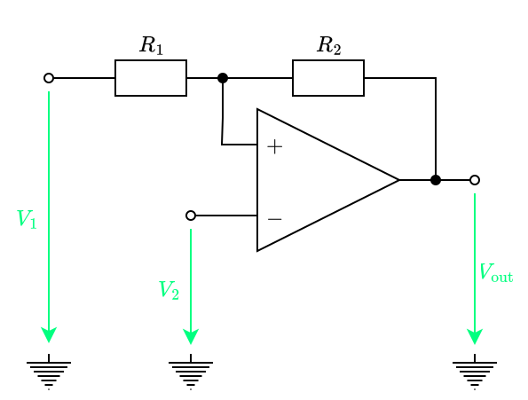
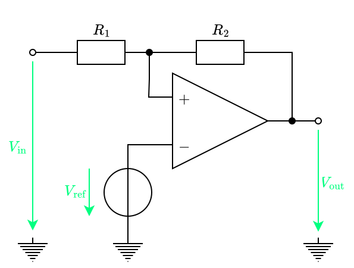
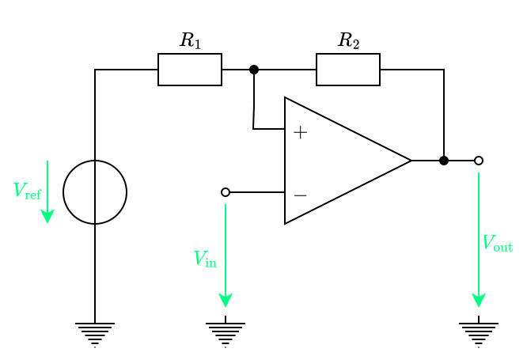

---
tags:
    - analog-circuits
    - electrical-engineering
---

# Schmitt Trigger

>[!THEOREM] Theorem: Threshold Vo

## Non-Inverting Schmitt Trigger

>[!THEOREM] Theorem: Threshold Voltages
>
>$$V_{\text{th, high}} = \left(1 + \frac{R_1}{R_2} \right)V_{\text{ref}} - \frac{R_1}{R_2} V_{\text{out, min}}$$
>
>$$V_{\text{th, low}} = \left( 1 + \frac{R_1}{R_2}\right)V_{\text{ref}} - \frac{R_1}{R_2}V_{\text{out, max}}$$
>
>>[!PROOF]-
>>
>>TODO
>>
>

## Inverting Schmitt Trigger

