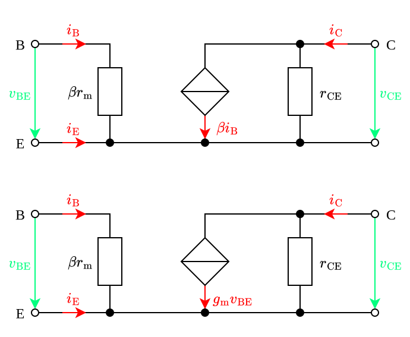

---
tags:
    - electronic-components
    - electrical-engineering
---

# Bipolar Junction Transistor

## Modeling

### Input Characteristic

The **input characteristic** of a [BJT](./Bipolar%20Junction%20Transistor.md) describes the relationship between the [base current](#Bipolar%20Junction%20Transistor) $I_{\text{B}}$ and the [base-emitter voltage](#Bipolar%20Junction%20Transistor) $V_{\text{BE}}$:

$$I_{\text{B}} = \begin{cases}+ \frac{I_{\text{S}}}{B} \exp\left( \frac{V_{\text{BE}}}{V_{\text{T}}} \right), & \text{NPN} \\ - \frac{I_{\text{S}}}{B} \exp\left( \frac{V_{\text{BE}}}{V_{\text{T}}} \right), & \text{PNP}\end{cases}$$

-  The **transfer saturation current** $I_{\text{S}}$ is strongly dependent on the [temperature](TODO). It increases roughly 8 % to 10 % per °C (doubling approximately every 8°C to 10°C). 

### Output Characteristic

The **output characteristic** describes the relationship between the [collector current](#Bipolar%20Junction%20Transistor) $I_{\text{C}}$ and the [collector-emitter voltage](#Bipolar%20Junction%20Transistor) $V_{\text{CE}}$.

### Current Transfer Characteristic

The **current transfer characteristic** describes the relationship between the [collector current](#Bipolar%20Junction%20Transistor) $I_{\text{C}}$ and the [base current](#Bipolar%20Junction%20Transistor) $I_{\text{B}}$.

$$I_{\text{C}} = B \cdot I_{\text{B}}$$

### Small-Signal Models

#### Hybrid-Pi Model

In the active region:

$$I_{\text{C}} = I_{\text{S}} \exp\left(\frac{V_{\text{BE}}}{V_{\text{T}}}\right)\left(1 + \frac{V_{\text{CE}}}{V_{\text{A}}}\right)$$

**Transconductance** $g_{\text{m}}$ and **transfer resistance**:

$$g_{\text{m}} = \left.\frac{\partial I_{\text{C}}}{\partial V_{\text{BE}}}\right\vert_{\text{OP}} = \frac{I_{\text{C}}^0}{V_{\text{T}}} \qquad r_{\text{m}} = \frac{1}{g_{\text{m}}} = \frac{V_{\text{T}}}{I_{\text{C}}^0}$$

**Differential input conductance** and **differential input resistance**:

$$g_{\text{BE}} = \left.\frac{\partial I_{\text{B}}}{\partial V_{\text{BE}}}\right\vert_{\text{OP}} = \frac{g_{\text{m}}}{\beta} = \frac{I_{\text{C}}^0}{\beta \cdot V_{\text{T}}} \qquad r_{\text{BE}} = \frac{1}{g_{\text{BE}}} = \frac{\beta \cdot V_{\text{T}}}{I_{\text{C}}^0} = \beta r_{\text{m}}$$

**Differential output conductance** and **differential output resistance**:

$$g_{\text{CE}} = \left.\frac{I_{\text{C}}}{V_{\text{CE}}}\right\vert_{\text{OP}} = \frac{I_{\text{C}}^0}{V_{\text{A}} + V_{\text{CE}}^0} \approx \frac{I_{\text{C}}^0}{V_{\text{A}}} \qquad r_{\text{CE}} = \frac{1}{g_{\text{CE}}} = \frac{V_{\text{CE}}^0 + V_{\text{A}}}{I_{\text{C}}^0} \approx \frac{V_{\text{A}}}{I_{\text{C}}^0}$$

