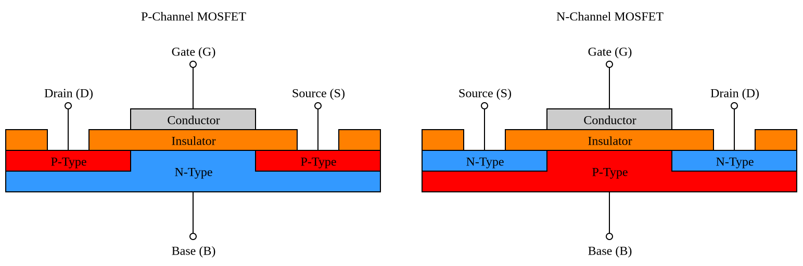
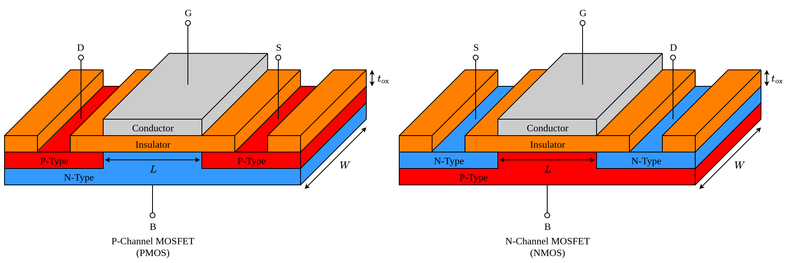
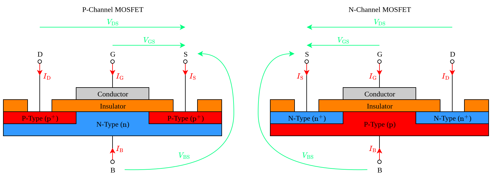
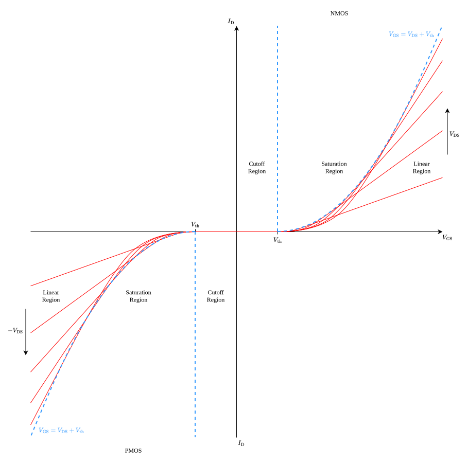
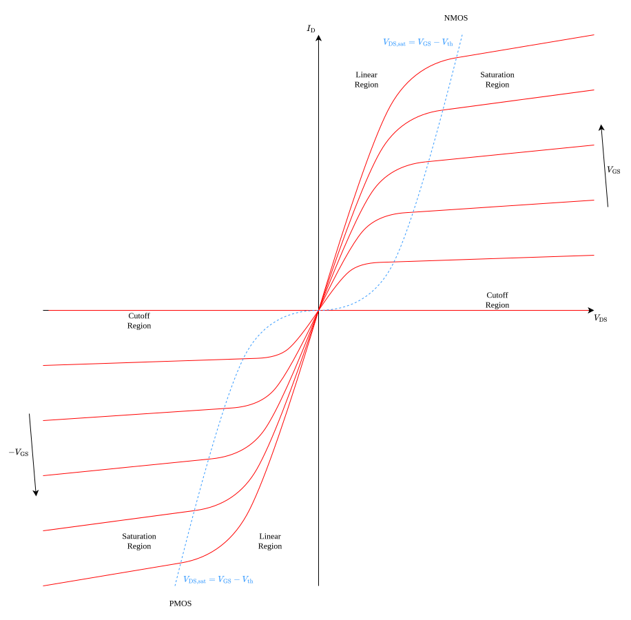
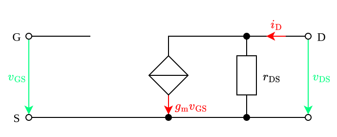

---
tags:
    - electronic-components
    - electrical-engineering
---

# Enhancement-Mode Metal-Oxide-Semiconductor Field-Effect Transistor

An **enhancement-mode metal-oxide-semiconductor field-effect transistor** (**eMOSFET**) is a [semiconductor](../../Chemistry/Semiconductors.md) [electronic component](../Electronic%20Components.md). It consists of two [P-type regions](../../Chemistry/P-Type%20Semiconductors.md) embedded into an [N-type region](../../Chemistry/N-Type%20Semiconductors.md) (**P-channel MOSFET** or **PMOS**) or two [N-type regions](../../Chemistry/N-Type%20Semiconductors.md) embedded into a [P-type region](../../Chemistry/P-Type%20Semiconductors.md) (**N-channel MOSFET** or **NMOS**). An insulating layer lies on top of them and an additional conducting layer lies on top of this insulating layer, over the separation between the two regions.

The underlying region ([N-type](../../Chemistry/N-Type%20Semiconductors.md) for PMOS and [P-type](../../Chemistry/P-Type%20Semiconductors.md) for NMOS) is called the **substrate**, **body** or **bulk**. The two separated regions of the opposite type ([P-type](../../Chemistry/P-Type%20Semiconductors.md) for PMOS and [N-type](../../Chemistry/N-Type%20Semiconductors.md) for NMOS) are known as the **source** and the **drain**, while the top-most conducting layer is called the **gate**.

In discrete [electronic components](../Electronic%20Components.md), the [source](#Enhancement-Mode%20Metal-Oxide-Semiconductor%20Field-Effect%20Transistor) and [bulk](#Enhancement-Mode%20Metal-Oxide-Semiconductor%20Field-Effect%20Transistor) are often tied together internally but this is not the case in [integrated circuits](../Integrated%20Circuits.md).

>[!NOTATION]
>
>The following symbols are used to explicitly indicate that the [bulk](#Enhancement-Mode%20Metal-Oxide-Semiconductor%20Field-Effect%20Transistor) and [source](#Enhancement-Mode%20Metal-Oxide-Semiconductor%20Field-Effect%20Transistor) are connected:
>
>|NMOS|PMOS|
>|:--:|:--:|
>|||
>
>The following symbols are used to explicitly indicate that the [bulk](#Enhancement-Mode%20Metal-Oxide-Semiconductor%20Field-Effect%20Transistor) and [source](#Enhancement-Mode%20Metal-Oxide-Semiconductor%20Field-Effect%20Transistor) are connected:
>
>|NMOS|PMOS|
>|:--:|:--:|
>|||
>
>The following symbols are also commonly used but give no information as to whether the [bulk](#Enhancement-Mode%20Metal-Oxide-Semiconductor%20Field-Effect%20Transistor) and [source](#Enhancement-Mode%20Metal-Oxide-Semiconductor%20Field-Effect%20Transistor) are connected or not:
>
>|NMOS|PMOS|
>|:--:|:--:|
>|||
>|||
>

## Operation

Th operation of an [enhancement-mode MOSFET](#Enhancement-Mode%20Metal-Oxide-Semiconductor%20Field-Effect%20Transistor) is characterized by the relationships between three key variables:

- the [voltage](TODO) $V_{\text{GS}}$ between the [gate](#Enhancement-Mode%20Metal-Oxide-Semiconductor%20Field-Effect%20Transistor) and the [source](#Enhancement-Mode%20Metal-Oxide-Semiconductor%20Field-Effect%20Transistor);
- the [voltage](#Voltage) $V_{\text{DS}}$ between the [drain](#Enhancement-Mode%20Metal-Oxide-Semiconductor%20Field-Effect%20Transistor) and the [source](#Enhancement-Mode%20Metal-Oxide-Semiconductor%20Field-Effect%20Transistor);
- the [current](../Current.md) $I_\text{D}$ flowing into the [drain](#Enhancement-Mode%20Metal-Oxide-Semiconductor%20Field-Effect%20Transistor).

|Region|PMOS|NMOS|
|:--:|:--:|:--:|
|Cutoff Region|$V_{\text{GS}} \ge V_{\text{th}}$|$V_{\text{GS}} \le V_{\text{th}}$|
|Linear Region|$V_{\text{GS}} \lt V_{\text{th}}$ and $V_{\text{DS}} > V_{\text{DS, sat}}$|$V_{\text{GS}} \gt V_{\text{th}} \text{ and } V_{\text{DS}} < V_{\text{DS, sat}}$|
|Saturation Region|$V_{\text{GS}} \lt V_{\text{th}}$ and $V_{\text{DS}} \le V_{\text{DS, sat}}$|$V_{\text{GS}} \gt V_{\text{th}}$ and $V_{\text{DS}} \ge V_{\text{DS, sat}}$|

$$I_{\text{D, PMOS}} = \begin{cases} 0, & \text{Cutoff Region} \\ -\beta \left((V_{\text{GS}} - V_{\text{th}})V_{\text{DS}} - \frac{1}{2}V_{\text{DS}}^2\right)(1 - \lambda V_{\text{DS}}), & \text{Linear Region} \\ -\frac{1}{2} \beta (V_{\text{GS}} - V_{\text{th}})^2 (1 - \lambda V_{\text{DS}}), & \text{Saturation Region} \end{cases}$$

$$I_{\text{D, NMOS}} = \begin{cases} 0, & \text{Cutoff Region} \\ \beta \left((V_{\text{GS}} - V_{\text{th}})V_{\text{DS}} - \frac{1}{2}V_{\text{DS}}^2\right)(1 + \lambda V_{\text{DS}}), & \text{Linear Region} \\ \frac{1}{2} \beta (V_{\text{GS}} - V_{\text{th}})^2 (1 + \lambda V_{\text{DS}}), & \text{Saturation Region} \end{cases}$$

### Transfer Characteristic

The **transfer characteristic** describes the relationship between $I_{\text{D}}$ and $V_{\text{GS}}$ for a fixed $V_{\text{DS}}$.

For $|V_{\text{GS}}| \lt |V_{\text{th}}|$, the [current](../Current.md) $I_{\text{D}}$ is effectively zero:

$$|V_{\text{GS}}| \lt |V_{\text{th}}| \implies |I_{\text{D}}| \approx 0$$

For $|V_{\text{GS}}| \gt |V_{\text{th}}|$, the relationship depends on the [drain-source voltage](#Operation) $V_{\text{DS}}$.

If $|V_{\text{DS}}| \lt |V_{\text{GS}}| - |V_{\text{th}}|$, then $I_{\text{D}}$ scales linearly with $V_{\text{GS}}$.

If $|V_{\text{DS}}| \gt |V_{\text{GS}}| - |V_{\text{th}}|$, then the [drain current](#Operation) $I_{\text{D}}$ scales quadratically with the [gate-source voltage](#Operation) $V_{\text{GS}}$:

$$I_{\text{D}} = \frac{\beta}{2} (1 + \lambda V_{\text{DS}}) (V_{\text{GS}} - V_{\text{th}})^2$$

- The parameter $\lambda$ quantifies the **channel length modulation**.

In the [saturation region](#Operation), the [drain current](#Operation) $I_{\text{D}}$ scales quadratically with with the [gate voltage](#Operation):

$$\text{Saturation Region} \implies |I_{\text{D}}| \propto |V_{\text{GS}}|^2$$

For $v$

### Output Characteristic

The **output characteristic** describes the relationship between $I_{\text{D}}$ and $V_{\text{DS}}$ for a fixed $V_{\text{GS}}$:

An important parameter in this case is the so-called **drain-source saturation voltage** $V_{\text{DS, sat}}$:

$$V_{\text{DS,sat}} = |V_{\text{GS}}| - |V_{\text{th}}|$$

#### Cutoff Region

For $|V_{\text{GS}}| \lt |V_{\text{th}}|$ (**cutoff region**), the [drain current](#Operation) $I_D$ is zero regardless of $V_{\text{DS}}$.

#### Linear Region

For $|V_{\text{GS}}| \gt |V_{\text{th}}|$ and $|V_{\text{DS}}| \le V_{\text{DS, sat}}$ (**linear region**), the relationship between $I_{\text{D}}$ and $V_{\text{DS}}$ is the following:

$$I_{\text{D, PMOS}} = -\beta \left((V_{\text{GS}} - V_{\text{th}})V_{\text{DS}} - \frac{1}{2}V_{\text{DS}}^2\right)(1 - \lambda V_{\text{DS}})$$

$$I_{\text{D, NMOS}} = \beta \left((V_{\text{GS}} - V_{\text{th}})V_{\text{DS}} - \frac{1}{2}V_{\text{DS}}^2\right)(1 + \lambda V_{\text{DS}})$$

For very small absolute values of the [drain-source voltage](#Operation) ($|V_{\text{DS}}| \ll |V_{\text{DS, sat}}|$), the quadratic term $\frac{1}{2} V_{\text{DS}}^2$ becomes negligible and the channel length modulation terms $(1\pm \lambda V_{\text{DS}})$ barely differ from $1$. The relationship between $I_{\text{D}}$ and $V_{\text{DS}}$ thus becomes predominantly linear, resembling a [resistor](../Network%20Analysis/One-Ports/Strictly%20Linear%20Resistive%20One-Ports.md) whose [resistance](../Network%20Analysis/One-Ports/Strictly%20Linear%20Resistive%20One-Ports.md) $R_{\text{DS, on}}$ is known as the **drain-source ON resistance**:

$$|I_{\text{D}}| \approx R_{\text{DS, on}} |V_{\text{DS}}|$$

The [drain-source ON resistance](#Linear%20Region) $R_{\text{DS, on}}$ depends on several things:

$$R_{\text{DS, on}} = \frac{1}{\beta |V_{\text{DS, sat}}|} =\frac{1}{\mu}\cdot\frac{1}{C_{\text{ox}}}\cdot \frac{L}{W} \cdot \frac{1}{|V_{\text{DS, sat}}|}$$

- $R_{\text{DS, on}}$ is inversely proportional to the [mobility](TODO) $\mu$ of the [majority charge carries](TODO) in the channel. As [temperature](TODO) rises, the [mobility](TODO) drops due to increased scattering and so $R_{\text{DS,on}}$ rises. Since the [mobility](TODO) of [holes](TODO) is in general roughly 3 times lower than that of [electrons](TODO), a [PMOS](#Enhancement-Mode%20Metal-Oxide-Semiconductor%20Field-Effect%20Transistor) will have around 3 times higher $R_{\text{DS, on}}$ in comparison with an [NMOS](#Enhancement-Mode%20Metal-Oxide-Semiconductor%20Field-Effect%20Transistor) under the same conditions.
- $R_{\text{DS, on}}$ is inversely proportional to the magnitude $|V_{\text{DS, sat}}|$ of the [drain-source saturation voltage](#Output%20Characteristic). For large absolute values of the [gate-source voltage](#Operation) $|V_{\text{GS}}|$, the magnitude $|V_{\text{DS, sat}}|$ of [drain-source saturation voltage](#Output%20Characteristic) $V_{\text{DS,sat}} = V_{\text{GS}} - V_{\text{th}}$ becomes very large and so $R_{\text{DS, on}}$ becomes very small. This means that the [output characteristic](#Output%20Characteristic) behaves like a [switch](TODO) for large $|V_{\text{GS}}|$. Typical values for $R_{\text{DS, on}}$ range from 5 mΩ to 10 Ω and are listed in datasheets.

When the [MOSFET](#Enhancement-Mode%20Metal-Oxide-Semiconductor%20Field-Effect%20Transistor) is in the [cutoff region](#Transfer%20Characteristic) ($V_{\text{GS}} \lt V_{\text{th}}$), the [current](../Current.md) $I_D$ is effectively zero, regardless of $V_{\text{DS}}$. 

When the [MOSFET](#Enhancement-Mode%20Metal-Oxide-Semiconductor%20Field-Effect%20Transistor) is in the [triode region](#Transfer%20Characteristic) ($V_{\text{GS}} \gt V_{\text{th}}$ and $V_{\text{DS}} \lt V_{\text{GS} - V_{\text{th}}}$), the dependence between $I_D$ and $V_{\text{DS}}$ is [linear](../../Mathematics/Analysis/Functional%20Analysis/Linearity/Linearity%20(Functions).md).

When the [MOSFET](#Enhancement-Mode%20Metal-Oxide-Semiconductor%20Field-Effect%20Transistor) is in the [saturation region](#Transfer%20Characteristic) ($V_{\text{GS}} \gt V_{\text{th}}$ and $V_{\text{DS}} \ge V_{\text{GS} - V_{\text{th}}}$), the [current](../Current.md) $I_D$ remains constant, regardless of how much $V_{\text{DS}}$ increases.

## Hybrid-Pi Model

